# Canonical GitHub architecture — proposal under review

```mermaid
flowchart LR
    P[Project MinhDucWeb — Master Control] --> I[Issue / sub-issue]
    I --> R[Requirement and approved SDD]
    R --> B[Work branch and verified base SHA]
    B --> PR[Draft PR]
    PR --> C[CI and independent QA]
    C --> V[Preview and source/artifact mapping]
    V --> A[PO approval]
    A --> REL[Reviewed release]
    REL --> D[Approved deployment and live verification]
```

GitHub Project is the navigation/control layer; Issue defines work; Markdown/JSON in Git defines versioned specification; PR records review; CI contains actual results; a release manifest connects source, artifact, environment/revision and URL. State transitions require evidence, not an agent's completion statement.

Keep one public `WebMinhDuc` repository for source, publishable docs, tests and releases. A separately approved private repository may hold restricted customer/commercial records. No frontend/backend/docs split is justified by appearance alone. Revisit boundaries only for a concrete technical, security or ownership reason and record an ADR.

Default branch remains `prototype`. [Current source/artifact drift](../../DEPLOYMENT-AUDIT.md) prevents treating it as a reproducible Sprint 2 build source. [PR #3](https://github.com/Kenbinhoainam/WebMinhDuc/pull/3) remains the existing Sprint 2 integration work. [PR #4](https://github.com/Kenbinhoainam/WebMinhDuc/pull/4) remains the original MDV2 proposal.

The current governance branch starts at `19ac2b3` and carries forward only PR #4's public documentation/configuration at the same paths. It neither merges that PR nor restores its old static tree. Before integration, PO chooses the PR sequence and resolves overlapping documentation diffs; never reset prototype to PR #4's old base.
